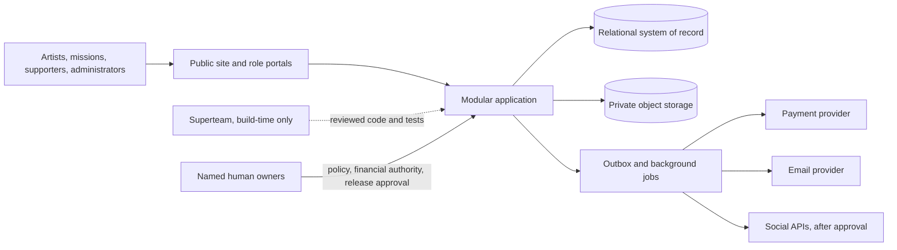

<!-- markdownlint-disable-file -->
# Task Research: Expression is Devotion Project

Project-level research for the Expression is Devotion platform, its domain/data architecture, solution options, delivery scope, launch stability, and the intended Superteam build workflow. This research uses the conversation context and current repository artifacts; it distinguishes verified local evidence from unverified external assumptions.

## Task Implementation Requests

* Consolidate an authoritative project research baseline suitable for planning and implementation.
* Evaluate data/platform and project-structure alternatives and select a recommended direction with evidence.
* Explain what should be built versus integrated, major dependencies, and phased stability gates.
* Incorporate the related discipleship framework and intended Superteam role while preserving human authority and noting access blockers.

## Scope and Success Criteria

* Scope: Current BRD, ERDs, architecture views/options, repository structure, linked repositories, delivery constraints, and operational risks.
* Assumptions: "This project" refers to the Expression is Devotion platform and the active repository. Superteam is intended as build-time assistance, not a runtime product dependency. The product stack is undecided.
* Success Criteria:
  * Findings cite repository paths and external authoritative sources where available.
  * Alternatives are compared against actual product and governance needs.
  * A recommended approach and dependencies are stated without presenting open decisions as settled.
  * Research gaps and actionable planning steps are explicit.

## Outline

1. Project scope and evidence status
2. Business workflows, controls, and unresolved decisions
3. Current repository, architecture, and data-model gaps
4. Relational, graph, hybrid, ontology, document, and assembly options
5. Build/integrate scope and effort-estimation limits
6. Superteam onboarding and human-authority boundaries
7. Recommended phases, stability gates, and implementation handoff

## Potential Next Research

* Obtain read access to `trust-fullstop/superteam` and inspect the actual agent configurations, tools, hooks, secret handling, and write/deploy permissions.
  * Reasoning: The user intends to use this squad to build the product; RDCF is not executable Superteam configuration.
  * Reference: `.copilot-tracking/reviews/2026-10-16/platform-foundation-and-options-review.md`
* Resolve legal and provider feasibility for fund custody, settlement, staged payouts, refunds, and country eligibility with qualified human owners.
  * Reasoning: These are the highest-impact gates before implementation of real-money flows.
  * Reference: `README.md:254-291`
* Establish named team capacity, budget, scope acceptance, RPO/RTO, support coverage, and pilot thresholds.
  * Reasoning: No calendar estimate or staffing plan can be defended without these inputs.
  * Reference: `docs/architecture/delivery-roadmap.md:6-24`

## Research Executed

### File Analysis

* `README.md:10-76`
  * Defines mission/art auction/donation goals, release scope, stakeholder roles, and primary workflows.
* `README.md:143-180`
  * Requires approval separation, staged funds, item/shipping separation, and mission tranche schedules; pooling and donation semantics remain unresolved.
* `README.md:184-216,254-310`
  * Captures privacy/security constraints, tentative stack candidates, and 52 open decisions including custody, provider eligibility, support, safeguarding, recovery, and build-versus-assemble.
* `docs/architecture/README.md:6-18,35-45`
  * Clearly marks modular-monolith and repository layout as proposals; no application code, package manifest, CI, tests, or deployment configuration exists.
* `docs/architecture/README.md:162-177`
  * Lists ERD reconciliation findings and open model changes.
* `docs/architecture/overview.md:31-57,82-84`
  * Aligns system context, board authority, relational recommendation, payment gate, stack uncertainty, and current repository state.
* `docs/architecture/business-view.md:25-47,61-66`
  * Captures actor responsibilities and the auction-to-tranche process, including unresolved donations, pooling, settlement, refunds, and chargebacks.
* `docs/architecture/data-model.md:17-23,37-58`
  * Recommends relational operational truth and identifies invariants for release caps, shipping exclusion, idempotency, approvals, audit, and privacy.
* `docs/architecture/technical-view.md:49-92`
  * Describes logical module ownership, server-side access controls, provider adapters, jobs, reconciliation, runbooks, and operational requirements.
* `docs/architecture/options/README.md:6-39`
  * Compares relational, graph, hybrid, and assemble-first paths; ontology docs distinguish RDF/OWL from database selection.
* `docs/architecture/ontology/README.md:6-66`
  * Provides a storage-neutral vocabulary and identifies unresolved meanings/cardinalities.
* `docs/architecture/delivery-roadmap.md:6-24,27-92`
  * Provides relative effort bands and six proposed delivery phases with payment, sandbox, and pilot gates.
* `docs/architecture/build-squad.md:6-18,42-78`
  * Defines Superteam as build-time tooling and preserves human product, legal, financial, privacy, and release ownership.
* `docs/architecture/related-projects.md:6-40`
  * Records RDCF submodule status and the failed Superteam access attempts.
* `docs/architecture/erd/auction-shipping-payments.mmd:1-18,43-100`
  * Shows conceptual auction, payment, tranche, release, report, and generic approval entities; no donation, mission-owned schedule, allocation, refund, or provider-event model is present.
* `docs/architecture/erd/applications-consent-access.mmd:1-17,28-50,77-100`
  * Makes organisation mandatory on applications, uses a scalar user role and polymorphic document owner, and models application approvals/audit.
* `docs/architecture/erd/identity-organisations.mmd:1-17,18-98`
  * Models user, organisation, mission, verification, membership, supporter, and artist data; address ownership is polymorphic and role cardinality is scalar.
* `docs/architecture/erd/content-formats-outreach.mmd:1-20,29-122`
  * Models testimony/media/social/newsletter/contact workflows; file references and relationships need privacy and integrity review.
* `projects/racecar-discipleship-framework/README.md:19,35-47`
  * States RDCF is exploration-only, not wired into a live agent session, and is not a replacement for Superteam.
* `projects/racecar-discipleship-framework/ROSTER.md:1-29`
  * Maps persona/role ideas for product, architecture, money/data, backend, frontend, cloud, QA, planning, research, coaching, and red team.
* `.copilot-tracking/research/2026-10-16/expression-is-devotion-project-findings.md`
  * Detailed delegated findings and evidence log. The subagent wrote the file to the date-level folder instead of the requested `subagents/` folder; the findings were read and consolidated here.

### Code Search Results

* `USER.role`
  * Scalar role appears in both identity-related ERDs, while `docs/architecture/ontology/README.md:14-16` says a person may hold multiple roles.
* `PAYMENT`, `TRANCHE`, `APPROVAL`
  * Payment ERD has auction-linked payments and payment-linked tranches, but no direct donation, mission-owned schedule, explicit pooling allocation, or common approval semantics.
* `owner_type/owner_id`, `target_type/target_id`
  * Polymorphic links occur in address, document, approval, and audit patterns; ordinary foreign keys do not enforce target existence.
* Superteam references
  * Local docs identify it as intended development tooling; repository content is unreviewed due HTTP 403/404 access responses.

### External Research

All external references below were accessed on 2026-10-16. Vendor documentation establishes product claims, not independent certification or a provider selection.

* PostgreSQL, [Transactions](https://www.postgresql.org/docs/current/tutorial-transactions.html)
  * Describes all-or-nothing transactions and rollback; relevant to coordinated record changes, but does not select PostgreSQL.
* PostgreSQL, [Transaction Isolation](https://www.postgresql.org/docs/current/transaction-iso.html)
  * Documents isolation levels and serialization anomalies; auction concurrency and fund allocation still require explicit design and tests.
* Neo4j, [Transaction management](https://neo4j.com/docs/operations-manual/current/database-internals/transaction-management/)
  * Documents ACID transaction semantics. Graph databases are not categorically incapable of transactional money workflows; workload fit and surrounding controls decide suitability.
* W3C, [RDF 1.1 Concepts and Abstract Syntax](https://www.w3.org/TR/rdf11-concepts/)
  * Defines RDF graph triples and datasets; RDF is a representation/data model, not a payout or authorization policy.
* W3C, [OWL 2 Web Ontology Language Overview](https://www.w3.org/TR/owl2-overview/)
  * Describes ontology semantics, reasoning, and profiles; formal OWL is justified by interoperability/reasoning needs, not required for a human-readable glossary.
* MongoDB, [Transactions](https://www.mongodb.com/docs/manual/core/transactions/)
  * Documents single-document atomicity and ACID multi-document transactions, while noting their costs and that transactions do not replace schema design.

### Project Conventions

* Standards referenced: HVE Core Markdown and writing-style requirements supplied in the session.
* Instructions followed: Task Researcher workflow; primary research edits are confined to `.copilot-tracking/research/`.
* File references in tracking documents use plain workspace-relative paths and line numbers; they are not markdown links.

## Key Discoveries

### Project Structure

The repository is a product-requirements, architecture, and linked-project workspace, not a running application. It contains the BRD, architecture views, four standalone Mermaid ERDs, four original HTML viewers under `html/`, `.copilot-tracking/` records, and the RDCF submodule under `projects/`. No application source, package manifest, CI pipeline, test suite, or deployment configuration exists. Superteam is intended for build-time assistance but is not checked out because this environment cannot read it.

The architecture index is the stakeholder entry point. The current views separate project overview, business workflows, data model, ontology, technical design, options, delivery gates, and squad/related-project boundaries. The proposed implementation tree is not the current filesystem and should remain explicitly marked as future structure until the stack/build decision is made.

### Business and Data Findings

The core business path is approval of a mission and artist, artwork allocation to one approved mission, auction or direct gift, provider settlement, mission-level fund allocation, evidence and approval, staged release, and supporter reporting. Shipping must remain separate from mission funding. Board members remain legally accountable.

The current ERDs are conceptual design artifacts, not implementation-ready migrations. Material reconciliation points:

1. Direct donations, guest/mission links, and their payment/tranche handling are not modeled.
2. Mission-owned tranche schedule/versioning and pooling allocations across artworks are not modeled.
3. Provider settlement events, idempotency, fees/currency, refunds, chargebacks, reversals, and reconciliation exceptions are not explicit.
4. Approval semantics differ across ERDs, and the auction-approver/payment-approver separation plus threshold-based dual approval are not enforceably demonstrated.
5. The ontology permits multiple roles per person, but ERDs use one scalar `USER.role`.
6. Artist application organization optionality and application-to-artwork traceability are unresolved; BRD item 42 relationship lines remain incomplete.
7. Testimony versus tranche evidence requiredness and extensible non-testimony proof are unsettled.
8. Media `file_url` fields do not demonstrate private storage keys, access checks, media rights/consent, classification, retention, moderation, or safeguarding lifecycle.
9. Polymorphic owner/target references need explicit integrity rules. Audit needs actor/resource/action semantics and records for permissions, restricted reads, approvals, and erasure exceptions.

Resolve semantics with product, finance, legal, privacy, and safeguarding owners before finalizing ERDs or deriving migrations.

### Implementation Patterns

* A modular monolith can preserve domain ownership without multiplying deployment/operations for an unstaffed early product.
* Relational state remains authoritative for payments, approvals, consent, and audit; provider adapters isolate replaceable external services.
* Use private object storage for file bytes and controlled references/metadata in the application store.
* Use idempotent provider callbacks and a replayable outbox/change feed for asynchronous work. Do not dual-write a relational store and graph projection in the request path.
* Treat graph data as a derived, non-authoritative projection only when a measured traversal use case exists; propagate privacy, access, and deletion controls.
* Treat ontology as a governed vocabulary now; introduce RDF/OWL only for a concrete semantic exchange or reasoning requirement.
* Agent roles can research, implement, test, and challenge code, while named humans retain legal, financial, product, privacy, production, and release authority.

### Complete Examples

Current repository shape:

```text
README.md                          Business requirements and 52 open decisions
html/                              Original interactive ERD viewers
docs/architecture/                 Overview, business, data, ontology, technical, options, roadmap
docs/architecture/erd/             Four standalone Mermaid ERDs
projects/racecar-discipleship-framework/  Independent RDCF submodule
projects/superteam/                 Pending read access and security review
.copilot-tracking/                  Research, plans, implementation and review records
```

Proposed logical runtime, not a finalized vendor/deployment plan:



### API and Schema Documentation

There is no product API contract, migration, or deployed schema yet. The four ERDs in `docs/architecture/erd/` are conceptual. External transaction and semantic-model references are listed under External Research; they inform design principles but do not establish a selected product or vendor.

### Configuration Examples

The current known linked repository is pinned through `.gitmodules` at `projects/racecar-discipleship-framework`, commit `47140f3668c97ef96eabdb759fae05fd25ade71b`. Superteam has no submodule configuration because read access is blocked. Its actual tools, permissions, hooks, secret handling, and current revision must be inspected before activation.

## Technical Scenarios

### Transactional Platform and Data Model

**Requirements:**

* Support linked mission, artwork, auction, payment, tranche, approval, consent, audit, privacy, and reporting records.
* Preserve integrity and explain every money state transition, including exceptions and reversals.
* Avoid a second source of truth without a demonstrated use case.

**Preferred Approach:**

* A stack-neutral modular monolith with a relational transactional source of truth, private object storage, provider adapters, and an outbox/job boundary.
* Keep the glossary/ontology storage-neutral. Add a graph projection only for a measured network-analysis/traversal need; add RDF/OWL only for semantic interoperability or reasoning requirements.
* Use capability-level managed services for commodity identity primitives, payment execution, email, object storage/scanning, KMS, hosting, and monitoring only after due diligence.

**Rationale:** The existing ERDs and product controls are relational in shape, while current requirements emphasize coordinated state transitions, approvals, audit, and reconciliation rather than graph-native access patterns. Neo4j documentation confirms that graph databases can support ACID transactions; the recommendation is therefore about current workload, schema/constraints, reporting, staffing, and operational simplicity, not a categorical graph limitation.

#### Considered Alternatives

| Alternative | Assessment |
| --- | --- |
| Graph-first | Technically capable of transactions depending on product, but introduces a model and operations shift without a current critical traversal requirement. Reconsider after a representative-query spike if graph traversal becomes core. |
| Relational plus graph | Useful for later impact/network analysis; adds eventual consistency, replay, access/deletion propagation, monitoring, and reconciliation. Defer until a named use case is funded. |
| RDF/OWL store | Appropriate for formal semantic exchange, shared vocabularies, or reasoning. Not needed for current transactional behavior; maintain a plain-language ontology meanwhile. |
| Document database primary | Can transact, including multi-document transactions in some products. Flexible payloads do not outweigh current cross-entity financial, approval, audit, and reporting needs without specific evidence. |
| Assemble-first suite | Evaluate by capability rather than assume one suite fits all. Potentially reduces commodity work but must prove custody/payout, authorization separation, data export, privacy, and vendor exit. |

### Delivery and Stability

**Preferred Approach:**

* Use the six documented phases: decisions/operating model; architecture/foundations; synthetic-data non-money slice; auction/provider sandbox; controlled pilot; measured expansion.
* Gate real-money work on qualified legal/finance decisions and written provider confirmation for custody, settlement, refunds, and target-country payouts.
* Gate pilot on reconciliation of duplicate, delayed, failed, refunded, reversed, and recovered provider events; tested backup restoration, incident escalation, rollback, access control, privacy, and named support ownership.
* Keep social publishing manual/reviewed at first if platform API approvals are not ready.

**Effort Guidance:** Existing `small-medium` through `extra large` bands are relative ordering only. No dates or staffing estimates can be justified without team composition/capacity, accepted scope, vendor/legal lead times, budget, operational targets, and support coverage. Re-estimate after Phase 1 with vertical slices and separate engineering time from external elapsed time.

#### Considered Alternatives

* Immediate full build: rejected because key legal/provider, operational, and product decisions block stable payment implementation.
* Full no-code/marketplace replacement: not selected without evidence it supports the custody, international payout, approval, data lifecycle, portability, and audit scenarios.
* Graph-first launch: rejected for current evidence, but not claimed technically impossible.

### Superteam Build Workflow

**Preferred Approach:**

* Treat Superteam as independently versioned development tooling, not part of the production application or authorization system.
* Obtain approved read-only access; inspect its real agent definitions, tool grants, hooks, network/shell access, secret handling, logging, and write/merge/deploy permissions. Pin and review a revision before activation.
* Onboard roles with BRD decision statuses, glossary, architecture, module boundaries, acceptance tests, open-question owners, and escalation path. Use synthetic data and isolated least-privilege credentials.
* Keep human approval for legal, finance, safeguarding, security/privacy policy, production deployment, and release decisions. Agents must never hold payment authority or production payment credentials.
* Use RDCF only as a role-discovery aid: its own README says it is exploratory and not wired to an agent runtime.

#### Considered Alternatives

* Treat RDCF as executable configuration: rejected by its README status and lack of verified runtime wiring.
* Grant the squad production authority: rejected; conflicts with BRD governance and human board accountability.
* Copy both repositories into one flattened source tree: not recommended; keep owned repos independently versioned and integrate by reviewed submodule/configuration boundaries.

## Selected Approach

For planning handoff, use a **capability-level assemble-first strategy around a small modular monolith with a relational system of record**. Build product-specific domain workflows and accountability controls; integrate commodity services after written legal, security, residency, eligibility, and support checks. Keep graph/RDF, microservices, and native app work deferred pending evidence. Use Superteam to implement bounded slices after source access and tool review; keep all consequential policy and release decisions with named humans.

## Recommended Next Steps

1. Assign named product, board/finance, legal, privacy/safeguarding, technical, operations, and support owners; decide deadlines and working capacity.
2. Resolve legal custody, sale/donation/tax/VAT, payment provider eligibility, pooled funds, donations, refunds, fees, failure fallback, auction rules, evidence, thresholds, and safeguarding.
3. Restore Superteam read access and review its real configuration/tool permissions before onboarding.
4. Approve architecture and nonfunctional targets (data residency, RPO/RTO, accessibility, retention, support, budget), then reconcile ERDs before schema/migration work.
5. Deliver a synthetic-data, no-money vertical slice; only then proceed to a provider sandbox and controlled pilot gates.

## Limitations

* This research is based on local BRD/architecture files, the accessible RDCF submodule, and public technical product documentation accessed 2026-10-16.
* Dutch legal, tax, licensing, AML, safeguarding, privacy, and payment custody conclusions are not established. Qualified human professionals and provider contract/sandbox review are required.
* Specific vendor coverage, prices, contracts, operational performance, and data-residency commitments were not verified.
* Superteam source/configuration and actual team availability remain unknown because the environment returned API 404 and Git 403. These responses prove an access failure here, not repository visibility or ownership.
* The delegated report was written to `.copilot-tracking/research/2026-10-16/expression-is-devotion-project-findings.md`, not the requested `subagents/` output location. Its findings have been incorporated; the primary document remains the authoritative consolidated handoff.
