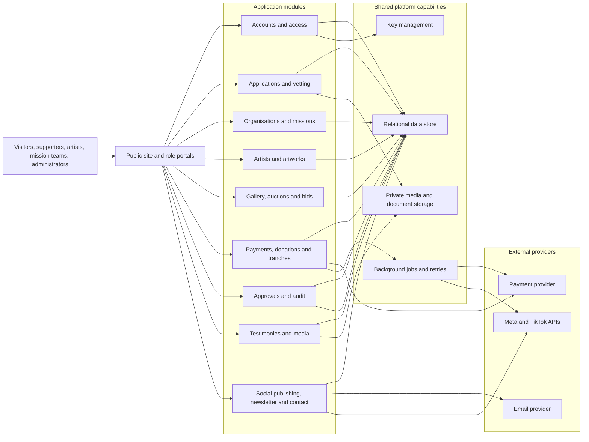

## Current State

The repository contains the business requirements, architecture views, four
standalone Mermaid ERD sources, four interactive HTML viewers under `html/`,
and an independent discipleship-framework submodule under `projects/`. Each
HTML viewer embeds Mermaid source in a JavaScript template literal, loads
Mermaid 11 from `esm.sh`, and renders the diagram in the browser. The `.mmd`
files in `erd/` are the convenient review format; the HTML files remain the
original interactive versions.

There is no application code, dependency manifest, build, or test tooling yet.
The Next.js, Vercel, Supabase, and Stripe Connect combination in the BRD is a
proposal, not an approved stack. The structure below is a logical starting
point, not a framework commitment.

## Architecture Views

| View | Purpose |
| --- | --- |
| [Overview](overview.md) | System context, scope, principles, and decision status |
| [Business view](business-view.md) | Actors, capabilities, workflows, and approval controls |
| [Data model](data-model.md) | Current ERDs, domain ownership, integrity, and model gaps |
| [Ontology](ontology/README.md) | Shared concepts and vocabulary, independent of storage |
| [Technical view](technical-view.md) | Modules, integrations, security, and reliability |
| [Options](options/README.md) | Relational, graph, hybrid, and assembled-platform alternatives |
| [Delivery roadmap](delivery-roadmap.md) | Build/integrate scope, delivery phases, and stability gates |
| [Related projects](related-projects.md) | Submodules and external project boundaries |
| [Build squad](build-squad.md) | How Superteam can build the product with human decision gates |

## Proposed Module Boundaries

The initial implementation should be a modular monolith: one deployable
application with explicit domain ownership and stable integration boundaries.
Keep screens and data operations close to the module that owns the business
rule. Split deployment only when operational evidence justifies it.



The diagram shows logical ownership, not a finalized runtime or deployment
design. Every privileged operation still requires server-side authorization;
approval separation and financial authority remain governed by the BRD.

## Proposed Repository Layout

Introduce implementation directories only after the build-versus-assemble and
technology decisions in BRD items 36-38 are settled. A stack-neutral modular
monolith could start with:

```text
apps/
  web/                       Public site, role portals, and admin experience
src/
  modules/
    identity/                Accounts, roles, authentication, and access
    applications/            Role applications, documents, and consent
    missions/                Organisations, verification, and mission records
    artists/                 Artist profiles, artworks, and contact requests
    auctions/                Listings, bids, checkout, and shipping quotes
    funds/                   Donations, payments, tranche schedules, and releases
    governance/              Approval policy, permissions, and audit trail
    content/                 Testimonies, media, and moderation
    outreach/                Post formats, social publishing, and newsletters
  platform/                  Shared storage, jobs, encryption, and observability
  integrations/              Provider adapters behind module-owned interfaces
db/
  migrations/
  seeds/
tests/
  unit/
  integration/
  end-to-end/
docs/
  architecture/
    erd/
    ontology/
    options/
projects/
  racecar-discipleship-framework/  Independent Git submodule
  superteam/                       Pending Codespace read access
html/                          Original interactive ERD viewers
```

Each module should own its application rules and persistence boundary. Avoid
direct cross-module table writes; use explicit interfaces or domain events.
Provider-specific APIs belong behind adapters so that a decision can change
without spreading vendor details through product modules.

## ERD Sources

| Domain | Mermaid source | Current interactive diagram |
| --- | --- | --- |
| Identity and organisations | [identity-organisations.mmd](erd/identity-organisations.mmd) | [HTML](../../html/erd_identity_organisations_v5.html) |
| Applications, consent, and access | [applications-consent-access.mmd](erd/applications-consent-access.mmd) | [HTML](../../html/erd_applications_consent_access_v5.html) |
| Auctions, shipping, and payments | [auction-shipping-payments.mmd](erd/auction-shipping-payments.mmd) | [HTML](../../html/erd_auction_shipping_payments_v4.html) |
| Content, formats, and outreach | [content-formats-outreach.mmd](erd/content-formats-outreach.mmd) | [HTML](../../html/erd_content_formats_outreach_v3.html) |

## Model Reconciliation Backlog

These items are findings from comparing the BRD with the current diagrams. They
are not schema changes and need product or technical decisions before database
implementation.

| Area | Finding | Source |
| --- | --- | --- |
| Supporter payments | `PAYMENT.supporter_id` exists without a relationship line to the supporter profile; `BID.supporter_id` is drawn as a link to `USER` instead. | ERD open item 42 |
| Artist applications | Link an approved artist application to resulting artwork and make the organisation link optional for artist applications. | ERD open item 43 |
| Integrity | Define database or application checks for polymorphic references and the three-media limit. | ERD open item 44 |
| Donations and tranches | Add quick donations, put the tranche schedule on the mission, and link tranche evidence to testimony. Define how proceeds from multiple artworks pool into mission tranches. | ERD open items 11, 12, and 45 |
| Shipping | `SHIPPING_RATE.artist_id` exists without a relationship line to `ARTIST_PROFILE`. | ERD open item 42 |
| Social publishing | `POST_ATTEMPT.render_id` exists without a relationship line to `POST_RENDER`. | ERD open item 42 |
| Contact requests | `CONTACT_REQUEST.artwork_id` exists without a relationship line to `ARTWORK`. | ERD open item 42 |
| Approvals | Keep auction readiness and payment release decisions separate; encode the rule that one person cannot approve both sides of the same flow. | GOV-2 |

## Next Decisions

Resolve the high-priority legal, finance, and technology items in BRD section
12 before building payment flows or selecting vendors. Then reconcile the ERDs
with confirmed rules and derive migrations from an agreed source of truth.