## Business Outcome

The platform helps artists support vetted Christian missions through donated
art, auctions, and direct gifts. It provides a traceable path from approval to
fund release and shares mission progress with supporters.

## Actors and Responsibilities

| Actor | Business responsibility | Platform relationship |
| --- | --- | --- |
| Mission team | Apply, describe the mission, report progress, submit evidence | Approved account and mission portal |
| Artist | Apply, donate artwork, choose an approved mission, describe the work | Approved account and artist portal |
| Supporter | Browse, bid, purchase, or give; receive progress updates | Account for bidding and purchase; donation account rules open |
| Visitor | Browse public content and request artist contact | No account for browsing or contact request |
| Follower | Subscribe or unsubscribe from updates | Newsletter identity separate from account identity |
| Administrator | Review applications, auction readiness, or payouts per permission | MFA and least privilege; distinct auction/payment approvals |
| Super-admin | Grant the four approval permissions | Sensitive permission changes are audited |
| Board | Retain legal and financial accountability | Outside the platform; human authority is required |

## Value and Control Flow

```mermaid
flowchart LR
  M[Mission application] --> V[Organisation and mission vetting]
  V -->|approved| A[Artist submits artwork]
  A --> S[Select one approved mission]
  S --> R[Readiness review]
  R --> Auction[Publish auction]
  Buyer[Supporter] -->|bid and pay in full| Auction
  Auction --> Settlement[Payment provider settles]
  Settlement --> Split[Separate item amount and shipping]
  Split --> Schedule[Mission tranche schedule]
  Schedule --> Evidence[Milestone report and evidence]
  Evidence --> Approval[Authorized release approval]
  Approval --> Release[Provider releases tranche]
  Release --> Update[Publish progress to supporter]
```

Quick donation follows a separate path into mission funding. Guest eligibility,
pooling, and tranche rules remain open. Shipping is recorded separately and
must not enter mission tranches. Provider settlement, refunds, chargebacks, and
released balances need explicit reconciliation rules.

## Core Capabilities

| Capability | Primary outcome | Control point |
| --- | --- | --- |
| Applications and vetting | Admit trusted people and organisations | Evidence, decision, verification cadence, consent |
| Missions and artists | Present approved missions and creators | Approval state and verified organisation relationship |
| Artwork and auction | Turn donated art into supporter participation | One approved mission per artwork; readiness approval |
| Payments and tranches | Move proceeds transparently to missions | Reconciliation, schedule, approval separation |
| Testimonies and outreach | Capture evidence and share mission stories | Rights, safeguarding, moderation, explicit publish action |
| Newsletter and contact | Maintain public communication | Confirmation, unsubscribe, spam protection, privacy |
| Governance | Preserve accountability | Permissions, MFA, audit, named human approvers |

## Decisions Before Money Flows

Resolve custody/legal structure, sale-versus-donation and tax treatment, VAT,
refunds, provider eligibility, tranche pooling, quick-donation rules, approval
thresholds, fees, and failed-mission handling with legal, finance, and provider
owners before real payments. See [BRD open items](../../README.md).