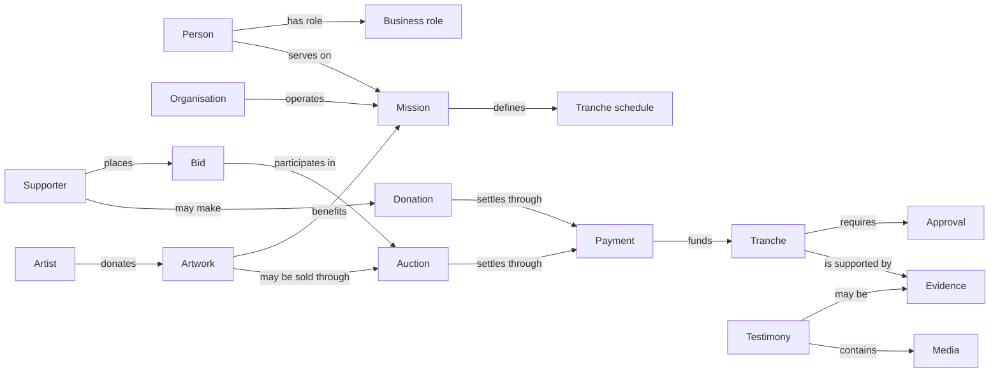

## Purpose

This is a lightweight business ontology: a controlled vocabulary for consistent
requirements, design, reporting, and future integrations. It is not a database
schema, graph-store decision, or formal OWL/RDF commitment.

## Core Concepts

| Concept | Meaning | Key relationship |
| --- | --- | --- |
| Person | A human who acts as a visitor, supporter, artist, missionary, administrator, or board member | A person may hold multiple roles subject to policy |
| Organisation | A legal or operational body with contacts, board members, and verification records | An organisation operates one or more missions |
| Mission | An approved funding purpose with a team, budget, evidence, and funding schedule | A mission can benefit from many artworks or gifts |
| Artist | A person with an approved creator profile | An artist donates artworks |
| Artwork | A donated item with description, media, and one selected approved mission | An artwork may be listed in an auction |
| Auction | A time-bounded process to sell an artwork | Supporters bid; readiness is approved before publication |
| Supporter | A person or, if approved, guest who funds a mission by bidding or giving | A supporter may place bids, pay, or donate |
| Donation | A direct gift, separate from an artwork sale | Guest, mission, payment, and tranche rules remain open |
| Payment | A provider-backed settlement with separately tracked item, shipping, fee, and status amounts | A payment may fund scheduled releases under agreed pooling rules |
| Tranche | An authorized portion of funds released to a mission | A tranche has a trigger, evidence, approval, release, and report |
| Testimony | A mission-linked story or progress report | A testimony may supply tranche evidence and may be published |
| Media | A private or publishable image, audio, or video asset | Media has rights, consent, classification, storage, and retention metadata |
| Approval | A recorded decision by an authorized human | An approval targets an application, auction, permission, or release |
| Consent | A versioned, timestamped grant or withdrawal for a defined use | Consent governs processing or publication of personal data and media |

## Concept Relationships

The diagram records target concepts, not approved database cardinalities. The
BRD has not settled guest donations, pooled proceeds, or whether a testimony is
mandatory evidence for each tranche.

## Vocabulary Governance

* Keep one canonical English term per concept; add Dutch display labels when
  launch languages are decided.
* Do not overload `payment`, `donation`, `sale`, `release`, or `tranche`; legal
  and finance owners must confirm their business meanings.
* Maintain identifiers and mappings to external vocabularies only for a real
  integration or reporting requirement.
* Consider RDF/OWL only if cross-organisation semantic exchange becomes a
  funded requirement. The relational model remains authoritative for current
  operational transactions.