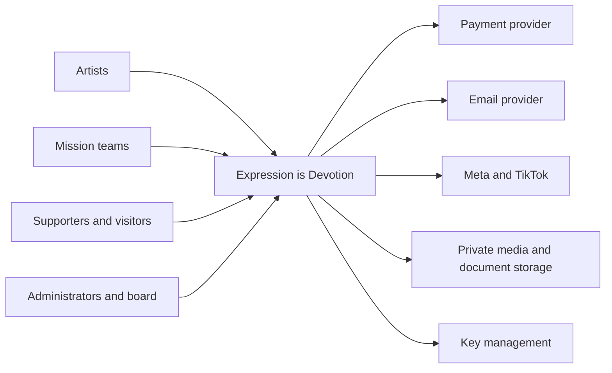

## Purpose

Expression is Devotion connects donated art and supporters to vetted missions.
It must make the path from mission approval through auction or gift, staged
release, and evidence-backed reporting understandable and auditable.

This is a current-state and proposal overview, not an approved implementation
specification. Product decisions in the root [business requirements](../../README.md)
take precedence. Proposed and open technical choices require owner review.

## System Context



The organization and its board retain financial and legal accountability.
External providers perform technical services but do not decide product policy.

## Architecture Principles

* Use one authoritative record for each financial state transition.
* Keep domain rules and permissions in the server-side application.
* Separate auction-readiness approval from payment-release approval and retain
  an audit trail for privileged actions.
* Store sensitive documents and media privately; authorize access and apply
  documented retention rules.
* Isolate provider-specific behavior behind replaceable integration adapters.
* Start with explicit module boundaries in one application; add distributed
  services or secondary data stores only for measured needs.
* Treat ontology as shared meaning and vocabulary, not as a database choice.

## Decision Status

| Topic | Status | Implication |
| --- | --- | --- |
| Product scope | Release 1 described in the BRD | Confirm open auction, donation, moderation, and operating rules |
| Application shape | Modular design required; deployment shape undecided | Modular monolith is a proposal |
| Transactional data | Current ERDs use relational entities and keys | Relational source of truth is the current recommendation |
| Graph and semantic models | No graph-first or semantic-exchange need identified | Evaluate separately; do not add a second store yet |
| Technology stack | Candidate stack only | Decide after legal, provider, residency, budget, and team review |
| Payment custody | Legal and provider feasibility open | No real-money launch until explicitly cleared |
| Social publishing | Platform reviews and channel rules are dependencies | Manual publishing can be an initial operating path |
| Build squad | Superteam is intended for development, but its repository is not accessible here | Project-specific roles and guardrails are documented separately |

## Documentation Map

Use the [business view](business-view.md) for actors and workflows, the
[data model](data-model.md) for entities and integrity, the
[ontology](ontology/README.md) for shared vocabulary, and the
[technical view](technical-view.md) for components and controls. Compare
approaches in [options](options/README.md), and use the
[delivery roadmap](delivery-roadmap.md) for phases and stability gates.
See [related projects](related-projects.md) and the
[build squad agreement](build-squad.md) for the independent repos and their
planned development role.

## Current Repository Shape

```text
README.md                       Business requirements and decision backlog
html/                           Original interactive ERD viewers
docs/architecture/              Stakeholder architecture views
projects/                       Independent related repositories
.copilot-tracking/               Research and planning state
```

There is no product application, package manifest, CI, or deployment
configuration yet. The candidate code layout belongs in the technical view and
should be adopted only after a build approach and stack are approved.