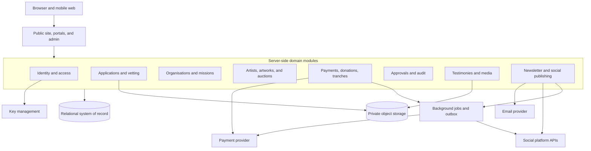

## Logical Architecture

The initial software shape is a proposed modular monolith: one web application
with module-owned rules and data access, plus managed infrastructure and
provider adapters. Technology and deployment choices remain open.



## Module Responsibilities

| Module | Owns | Boundary rule |
| --- | --- | --- |
| Identity and access | Authentication integration, roles, account state, authorization policy | Authentication identity is not domain authorization |
| Applications and vetting | Versioned forms, consent, documents, verification decisions | Restricted evidence remains private and auditable |
| Missions and artists | Organisation, mission, membership, artist profile, artwork lifecycle | Approval state controls selection and publication |
| Auctions | Auction, bids, winner, readiness, shipping quote | Define race-safe bids and non-paying-winner handling |
| Funds | Donations, provider settlements, tranche schedules, releases, reconciliation | Idempotent callbacks; shipping excluded from mission tranches |
| Governance | Permissions, approval policy, restricted-read audit, separation of duties | Enforce on the server; humans retain financial authority |
| Content | Testimony, media metadata, rights, moderation | Enforce consent, safeguarding, and publication state |
| Outreach | Newsletter state, post formats, channel publishing, contact requests | Provider limits are isolated; failed jobs are visible |

These boundaries may share a database and deployment initially. Modules should
not bypass each other's business rules through direct table writes.

## Security and Privacy Baseline

* Classify personal, child-safety, financial, and public data; minimize fields
  and document retention and legal-basis ownership.
* Apply server-side authorization to every read and write; require MFA for
  administrators; test approval separation as an invariant.
* Keep payment credentials with the payment provider. Store provider references,
  not card or bank data.
* Keep documents and media private; use short-lived signed access where
  appropriate, malware scanning, checksums, and restricted-access audit events.
* Encrypt sensitive data with keys managed separately from application data;
  define rotation, backup, and recovery ownership.
* Maintain versioned consent and rights records; support erasure with explicit
  lawful-retention exceptions.
* Agree EU hosting, subprocessors, processing terms, cookie behavior, and
  incident notification before production data is collected.

## Reliability and Operations

Payment callbacks and social jobs need idempotency, retry policy, dead-letter
visibility, reconciliation, and operator runbooks. Audit records should be
append-only for actions requiring accountable evidence. Monitor settlement and
release states, failed integrations, queue age, backup health, authorization
failures, and support incidents.

Do not make production launch depend on unreviewed social APIs. Keep a
human-controlled publishing path, and exercise backup restoration, payment
reconciliation, incident escalation, and rollback before a pilot.

## Candidate Software Layout

```text
apps/web/                       Public site, role portals, admin
src/modules/                    Domain modules listed above
src/platform/                   Authorization, jobs, storage, audit, observability
src/integrations/               Payment, email, identity, and social adapters
db/migrations/                  Reviewed schema changes
tests/unit/                     Domain rule tests
tests/integration/              Persistence and provider contract tests
tests/end-to-end/               Critical product and operations journeys
ops/                            Deployment, backup, alerts, and runbooks
```

Create these folders only after the build approach and stack are approved. The
current repository remains a requirements, architecture, and squad workspace.