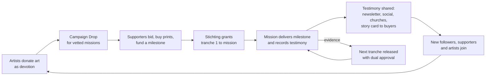

## The problem, in her words and ours

Missions need **trustworthy, recurring funding** and a simple way to **share
testimonies** with the people who carry them in prayer and giving. Christian
artists want their gift to **serve**, not just sell. Supporters want to know
**their gift made a difference**. Today these three groups rarely meet, and
when they do, trust and follow-up are manual and fragile.

Expression is Devotion connects them: **art becomes funding, funding becomes
milestones, milestones become testimonies, testimonies bring the next artists
and supporters.**

## Value proposition per group

| Group | Job to be done | What they get | What they give |
| --- | --- | --- | --- |
| **Missions** (storytellers) | Fund concrete work without spending weeks fundraising | Staged grants, a mission page, a ready audience, testimony templates | Vetting documents, milestone plan, one testimony per milestone |
| **Artists** (creators) | Use their gift as worship and service, and be seen | Artist page, story of their "why", exposure to a faith audience, optional commission leads | One donated piece per drop (or print rights) |
| **Supporters** (patrons) | Give with joy and see the fruit | Beautiful art or prints, milestone updates, a story card, tax receipt where eligible | Bids, purchases, donations, monthly gifts |
| **Churches and groups** (hubs) | Engage their people in mission and creativity | Ready-made "Gallery Sunday" kit, mission stories for services, youth art challenges | Venue, audience, volunteers |
| **Followers** | Stay inspired | Monthly testimony letter, no account needed | Attention, prayer, shares |

## The Devotion Engine flywheel

Every turn of the wheel produces **money for missions** and **proof that it
worked**. Proof is the fuel: it makes the next drop easier to fill and to sell.

## The core product: a Campaign Drop

A Campaign Drop is the unit of everything: funding, storytelling, operations.

| Element | Startup default | Why |
| --- | --- | --- |
| Missions | 1 to 3 vetted missions per drop | Focus beats choice overload; easier storytelling |
| Goal | Public goal per mission, split into 2 to 4 milestones | Supporters see exactly what they fund; maps to BRD tranches |
| Art | 10 to 25 donated works | Manageable for volunteers; enough variety |
| Window | 7 to 10 days online, optional live closing evening | Urgency creates bids; a closing event creates community |
| Ways to give | Bid, buy a print, fund a milestone, join the Devotion Circle | Every visitor can give at their own level |
| Story | Mission video or voice note, artist "why" per piece | Keeps the essence: expression is devotion |
| After the drop | Tranche 1 within 14 days, testimony within 60 days, final report within 6 months | Trust compounds when follow-up is visible |

Suggested yearly rhythm (aligned to the Christian calendar and giving seasons):

| Drop | Window | Theme example |
| --- | --- | --- |
| Lent / Easter Drop | March to April | "New life" |
| Pentecost Drop | May to June | "Every tongue, every nation" |
| Harvest Drop | September to October | "Sow and reap" |
| Advent Drop | November to December | "Light in darkness" (strongest giving season) |

Between drops: **micro-drops** (one artist, one mission, 72 hours) keep the
channel alive with almost no effort.

## Community engine

### Roles inside the community

| Role | Description | Recognition |
| --- | --- | --- |
| Founding Artists | First 12 artists who donate to the pilot drop | Named on the site forever; first pick of drop themes |
| Devotion Circle members | Monthly givers (for example 5, 15 or 50 euro) | Quarterly behind-the-scenes call with a mission; name on the wall (opt-in) |
| Church Hubs | Churches that host a Gallery Sunday or a youth art challenge | Hub badge, mission visit or video call |
| Ambassadors | Volunteers who share each drop with their network | Ambassador kit, personal referral link, thank-you note from missions |
| Prayer partners | Followers who commit to pray for a mission during its drop | Prayer points in the newsletter, answered-prayer updates |

### Rituals that make it a community, not a shop

1. **Drop opening**: a short livestream or video with the missionaries and artists.
2. **Story card**: every buyer receives a card with the artwork, the artist's
   "why", and a QR code to the mission's live testimony page.
3. **Milestone moments**: when a tranche is released, all supporters of that
   mission receive one short update with a testimony.
4. **Closing evening**: optional live event in a church or gallery, worship plus
   final bids.
5. **Annual Expression Night**: a celebration of everything funded that year.

### Growth loops

| Loop | Mechanism | Measured by |
| --- | --- | --- |
| Artist loop | Every artist shares their own piece with their audience using a ready share kit | Visitors per artist link |
| Buyer loop | Story card QR code leads friends and family to the mission page | Story-card scans |
| Testimony loop | Testimonies are posted on social and in churches, and every post ends with "join the next drop" | Followers gained per testimony |
| Church loop | One Gallery Sunday introduces a whole congregation; youth art challenges create new artists | New artists and subscribers per hub |
| Circle loop | Monthly givers are invited to bring one friend per year | Circle growth rate |

## Metrics

**North Star:** milestones funded **and** evidenced per quarter.

| Stage | Metric | Pilot target (suggested, to confirm) |
| --- | --- | --- |
| Acquire | Newsletter subscribers | 500 by the end of the pilot drop |
| Activate | Visitors who give in any form | 3 to 5 percent of drop visitors |
| Fund | Funds raised per drop | 5,000 to 10,000 euro for the pilot |
| Trust | Tranches released with evidence on time | 100 percent |
| Retain | Supporters who give again in the next drop | 30 percent |
| Grow | Artists who donate again | 50 percent |
| Sustain | Running costs covered by the operations fund | 100 percent, mission funds untouched |

These map directly to BRD objectives BO-1 to BO-6.

## What we deliberately do not do (yet)

* No always-on marketplace with hundreds of listings.
* No native mobile app; a mobile-first website (installable later) is enough.
* No automatic API posting to Instagram, Facebook and TikTok before the
  platform approvals are in place; scheduled manual posting works from day one.
* No instalment payments, no storing of card or bank data (as in the BRD).
