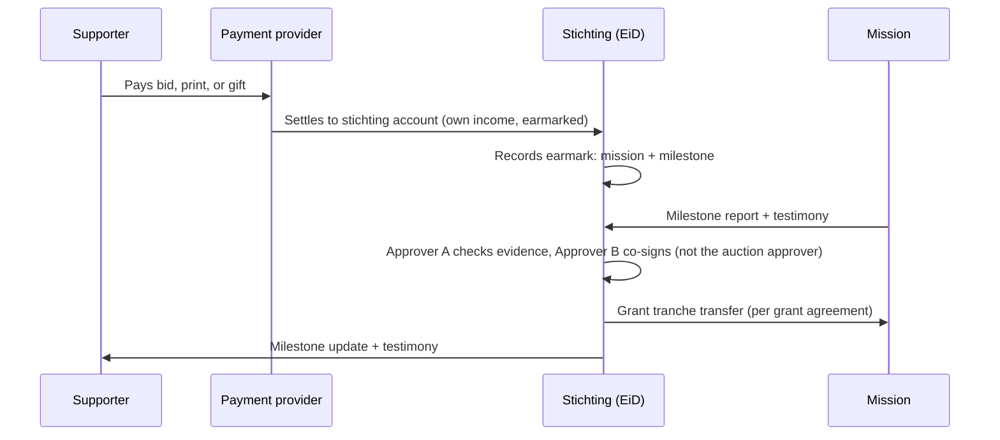

## Two separate money streams

The engine runs on two streams that are **never mixed**. This is the single
most important trust rule and keeps the "100% to mission" promise honest.

| Stream | Source | Use | Promise to supporters |
| --- | --- | --- | --- |
| **Mission fund** | Auction proceeds (item amount), print margins, fund-a-milestone gifts, earmarked donations | Grants to missions in milestone tranches | 100% of the item amount reaches the mission, minus only payment provider fees (shown openly) |
| **Operations fund** | Devotion Circle operations share, optional checkout tip, drop sponsors, foundation grants | Tools, hosting, insurance, print samples, events | Published yearly in a one-page cost report |

Shipping stays outside both (BRD PAY-3): the buyer pays it and the artist ships.

## The grant model (how money moves)

* The artist **donates** the artwork to the stichting; the stichting sells it.
* The stichting signs a short **grant agreement** with each mission: milestones,
  amounts or percentages, evidence, and what happens if a milestone fails
  (funds move to the mission's next milestone or to a named reserve mission,
  never back into operations).
* This keeps all money in **one regulated bank account and one provider**,
  inside a normal charity structure, and makes BRD open items 1, 8 and 15
  much simpler. **It must be confirmed by a Dutch charity lawyer or
  accountant before the first payment** (decision D1).

## Funding channel portfolio

Start with the first four. Add others only when the previous ones run smoothly.

| # | Channel | How it works | Stage | Effort | Impact | Notes |
| --- | --- | --- | --- | --- | --- | --- |
| 1 | **Campaign Drop auctions** | Timed online auction of donated art, 7 to 10 days | 0 | Medium | High | Core of the BRD; batch operations per drop |
| 2 | **Fund a milestone** | Direct gift to a named milestone ("solar panels for the clinic: 1,200 euro") with a progress bar | 0 | Low | High | Implements the BRD quick-donate button with clear rules |
| 3 | **Devotion Circle** | Monthly gift (5, 15, 50 euro); the giver chooses 100% missions or 90/10 missions/operations | 0 | Low | High, recurring | In NL a written five-year periodic gift to an ANBI can be fully deductible for the giver (confirm with advisor) |
| 4 | **Prints and editions** | With the artist's consent, sell print-on-demand prints of drop artworks | 0 to 1 | Low | Medium, long tail | Print partner ships directly, so no stock and no volunteer shipping |
| 5 | **Gallery Sunday (church hubs)** | Physical exhibition in a church with QR codes to bid or give | 1 | Medium | High for growth | Biggest community lever; one kit, reused everywhere |
| 6 | **Live closing evenings** | Worship, testimonies, live final bids, small ticket or free-will offering | 1 | Medium | Medium to high | Turns a sale into a celebration |
| 7 | **Match the drop** | A business or donor matches gifts up to an amount during the drop | 1 | Low | High | Matching is proven to lift response; easy to ask for |
| 8 | **Drop sponsor** | A company covers drop costs in return for a thank-you mention | 1 | Low | Operations | Keeps the operations fund healthy |
| 9 | **Annual products** | Advent calendar, cards or a yearly art book from donated works (with consent) | 2 | Medium | Medium | Seasonal and giftable |
| 10 | **Artist commissions with mission tithe** | Visitors request a commission via the artist page; the artist pledges a share to a mission | 2 | Low | Low to medium | Builds on BRD FR-ART-3 contact requests |
| 11 | **Creative workshops and retreats** | Paid workshops led by artists; proceeds to missions or operations | 2 | Medium | Medium | Strong community builder |
| 12 | **Foundations and grants** | Apply to Christian and cultural foundations for operations or growth | 0 onward | Medium | Medium | Funds staff time and the Stage 1 build |
| 13 | **Legacy and major gifts** | Later, once there is a track record | 3 | Low | High, rare | Needs a proven history first |

## Illustrative economics of one pilot drop

Illustrative only; every number is an assumption to replace with real data.

| Line | Assumption | Amount (euro) |
| --- | --- | --- |
| Auction | 15 works, average winning bid 300, 80% sell | 3,600 |
| Fund a milestone | 60 gifts, average 40 | 2,400 |
| Prints | 40 prints, net margin 15 each | 600 |
| Match | One business matches up to 1,500 | 1,500 |
| **Mission fund raised** | | **8,100** |
| Payment provider fees | About 2% (check current pricing) | -160 |
| **Granted to missions** | | **about 7,940** |
| Devotion Circle | 40 members x 15 average x 10% operations share x 12 months | 720 per year |
| Optional checkout tips | 30% of givers add about 3 | about 150 |
| Stage 0 tooling | See the lean stack | about 50 to 120 per month |

**Break-even for operations** at Stage 0 needs only about 40 to 60 Devotion
Circle members or one drop sponsor per year. That is a realistic first-year goal.

## Rules that keep the engine trustworthy

1. Mission funds and operations funds are separate ledgers from day one.
2. Fees are shown openly at checkout; no hidden platform percentage on art.
3. Every euro is earmarked to a mission and milestone at the moment of payment.
4. Tranche releases need evidence and two people, one of whom did not approve the auction (BRD GOV-2, GOV-3).
5. Funds for a failed milestone follow the grant agreement fallback, published in advance.
6. A yearly public report shows: raised, granted, held for milestones, operations costs.

## Questions for the owner

* Which missions are ready for the pilot drop, with a milestone plan?
* Is the 90/10 Devotion Circle option in line with the vision, or should operations be funded only by sponsors and grants?
* Are prints acceptable to the founding artists (rights, quality, signature)?
