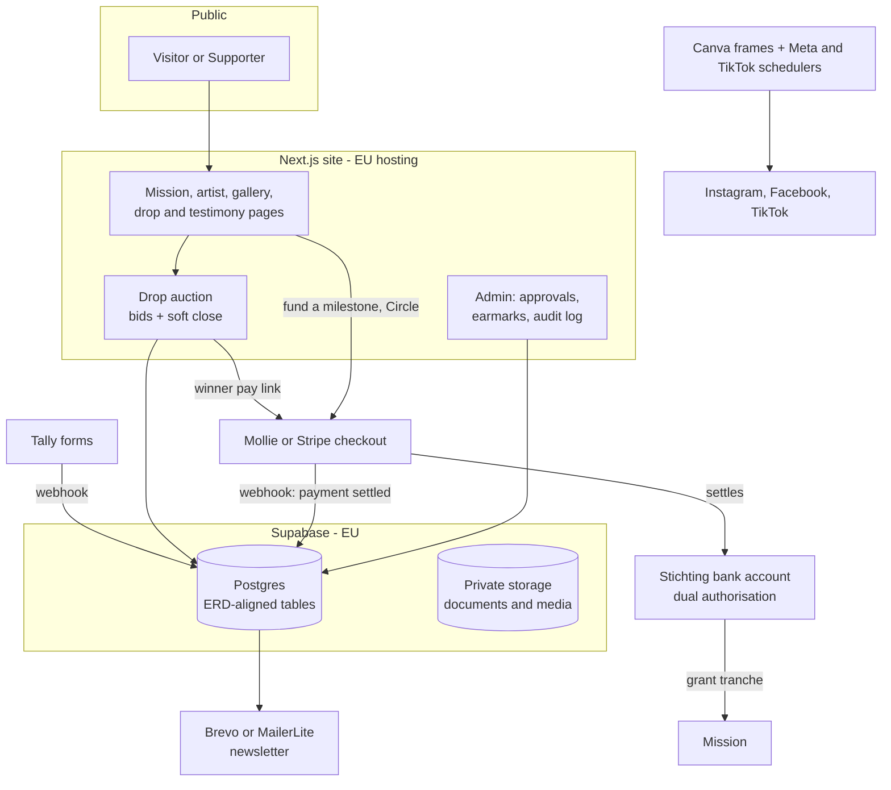

## Three stages, one data model

| Stage | Goal | Build style | Monthly running cost (indicative) | Move on when |
| --- | --- | --- | --- | --- |
| **0. Launch** | First two Campaign Drops, first tranches released | Thin custom site + assembled EU services | about 50 to 120 euro | 2 drops done, about 15k euro raised, manual work above 10 hours per drop |
| **1. Platform v1** | Self-service portals, own auction engine, approvals in-app | Custom modules from the ERD on the same codebase | about 100 to 250 euro | 6+ missions, 50+ artists, recurring drops every quarter |
| **2. Scale** | Automation, API posting, dashboards, more languages | Add BRD "later" modules | Grows with usage | Evidence from metrics, not ambition |

Costs are indicative; check current vendor pricing before committing.

## Stage 0 reference stack

The rule: **build the devotion-specific core, rent everything commodity, and
keep every record in one EU database shaped like the ERD.**

| Need | Recommended | Why this choice | Alternatives |
| --- | --- | --- | --- |
| Website and portals | Next.js (already suggested in the BRD) in this repo | One codebase from day one to Stage 2; works with AI coding tools | Webflow or Framer for pages only (but data lives elsewhere) |
| Hosting | Vercel (EU region) or Netlify | Free or low tiers, preview per pull request | Azure Static Web Apps, Cloudflare Pages |
| Database, auth, storage | Supabase (EU region) | Postgres matches the relational ERDs; row-level security; MFA for admins; private storage buckets | Neon + Auth.js, Azure Postgres |
| Payments | Mollie or Stripe, standard checkout to the stichting account | iDEAL, cards and SEPA; no card data on our side (PAY-6); no Connect needed in the grant model | Stripe Connect or Mollie Connect only in Stage 2 if direct payouts are needed |
| Tranche transfers | Business bank account with **dual authorisation** | Enforces two-person release (GOV-3) without building anything | In-app approval flow in Stage 1 |
| Forms (applications, artwork intake, testimonies) | Tally (EU) with webhooks into Supabase, or native forms | Fast to change without code; consent checkboxes stored with timestamp | Native forms in Stage 1 |
| Newsletter | Brevo or MailerLite (EU) | Double opt-in (FR-NEW-3), unsubscribe per subscriber (FR-NEW-1), free starter tiers | Resend + own lists in Stage 1 |
| Social posting | Meta Business Suite (Instagram + Facebook) and TikTok's own scheduler | No app review needed; works on day one (BRD open item 38) | Buffer or Later; direct APIs in Stage 2 |
| Post formats (frames) | Canva brand templates per platform and aspect ratio | Implements FR-CON-4 "frames" with zero code | Programmatic rendering in Stage 2 |
| Prints | EU print-on-demand partner (for example Gelato or Printful EU) | No stock, partner ships | Local print shop for limited editions |
| Spam and bot protection | Cloudflare Turnstile | Free, privacy-friendly (NFR-5, open item 33) | hCaptcha |
| Bookkeeping | Dutch accounting tool with two projects: Mission fund and Operations fund | Separate ledgers from day one | Accountant-managed spreadsheet at the very start |
| Analytics | Plausible or a cookieless alternative | No cookie banner needed for analytics | None at all for the pilot |

## Stage 0 architecture



## The minimum custom build for Stage 0

Only these parts are custom, because no product does them the devotion way:

1. **Public pages** following the Figma wireframes and the brand palette
   (pink #FF0081, blue #1A66DE, yellow #FFD400, background #FFFDF7, Inter).
2. **Drop auction**: lots, bids, start price, end time with a two-minute soft
   close, highest bid wins, winner receives a payment link with a 72-hour
   deadline, then the offer passes to the second bidder (sensible defaults for
   BRD open items 18 and 19, owner to confirm).
3. **Fund a milestone**: a progress bar per milestone and a checkout link.
4. **Admin**: approve applications, readiness and payments with separation of
   duties, record earmarks and tranche releases, everything written to the
   audit log.

Everything else is configured, not coded.

## ERD-aligned Stage 0 schema

Use the ERD names so that Stage 1 is a migration, not a redesign. Tables
outside this list stay in the ERDs for later.

| Domain (ERD) | Stage 0 tables | Notes |
| --- | --- | --- |
| Identity and organisations | organisation, person, role_assignment | Admin MFA via Supabase Auth |
| Applications, consent, access | application, consent_record, document | Consent stored per type and policy version (DAT-1) |
| Auction, shipping, payments | **campaign** (new), artwork, auction, bid, payment, donation, tranche_schedule, tranche_release, approval | Item amount and shipping kept apart (PAY-3) |
| Content, formats, outreach | testimony, media_asset, subscriber, post_log | post_log records manual posts for the metric in BO-3 |
| Cross-cutting | audit_log | Every approval, permission change and restricted read (GOV-4) |

**Proposed ERD change:** add a **campaign** entity (a drop) that groups
missions, artworks and auctions in a time window. It is the only new concept
this package introduces, and it should be added to
docs/architecture/erd/auction-shipping-payments.mmd after owner approval.

## Future-proofing rules

1. **One source of truth.** Postgres holds the canonical record; external tools
   hold copies. Every tool must offer export or an API.
2. **Stable IDs.** UUIDs everywhere; external IDs (payment, newsletter, form)
   are stored as references, never as the primary key.
3. **Adapters at the edges.** Payment, email, forms and social sit behind small
   interfaces so a vendor can be swapped without touching the domain.
4. **Events, not just state.** Write domain events (bid placed, payment
   settled, tranche approved, testimony published) to the audit log. They
   power the later dashboard and any graph or AI analysis.
5. **Consent first.** No form goes live without consent fields mapped to
   consent_record.
6. **Locale-ready.** Dutch and English strings from the start; content tables
   carry a locale column (NFR-9).
7. **Modules map to ERD domains** (NFR-1): each folder owns its tables and screens.
8. **AI assists, humans decide** (GOV-6). Good early AI uses: draft a post
   frame from a testimony, translate NL and EN, write alt text, summarise
   milestone evidence for approvers. Never: approve, release, or vet.
9. **Backups and restore tested** before the first real payment.
10. **Write decisions down** in docs/architecture as they are made.

## Suggested repository layout (when code starts)

```text
apps/web/                 Next.js site and portals
  app/(public)/           home, missions, artists, gallery, drops, testimonies
  app/(portal)/           missionary, artist, supporter portals (Stage 1)
  app/(admin)/            approvals, earmarks, tranches, audit
packages/domain/          one folder per ERD domain, with types and rules
packages/adapters/        payments, email, forms, social
supabase/migrations/      SQL migrations generated from the ERD subset
docs/                     BRD, architecture, startup package
```
