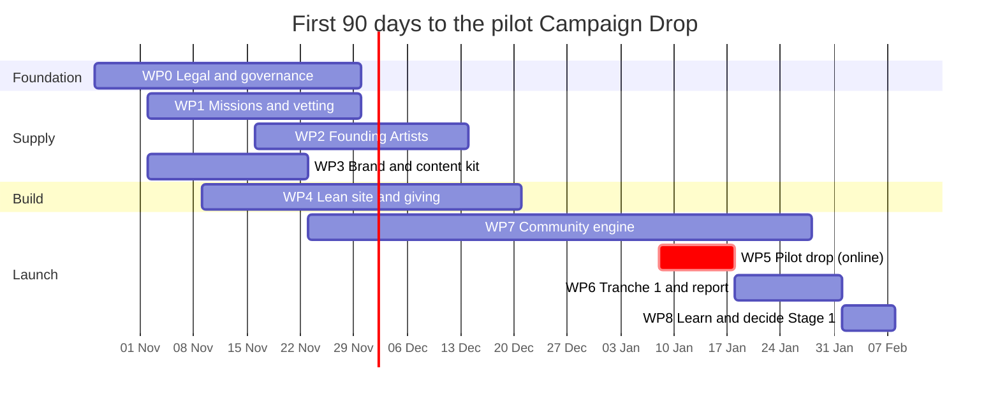

## Lean team (volunteer-friendly)

Separation of duties needs at least three people (BRD open item 26). This
setup works with five, and some roles can be combined except where marked.

| Role | Focus | Hours per week (pilot) | BRD permission | Must not also hold |
| --- | --- | --- | --- | --- |
| **Founder and owner** (Teresa) | Vision, missions, artists, story | 6 to 10 | Super-admin, approve missionary applications | Approve payment |
| **Artist lead** | Artist intake, curation, readiness | 2 to 4 | Approve artist applications, approve auction readiness | Approve payment |
| **Treasurer** (board) | Bookkeeping, earmarks, tranche releases | 2 | Approve payment (approver A) | Approve auction readiness |
| **Chair** (board) | Oversight, second signature | 1 | Approve payment above threshold (approver B) | Approve auction readiness |
| **Builder** | Site, data, automation | 4 to 8 during build, 1 after | Technical admin (no approvals) | Any approval |
| Story and social (optional) | Testimonies, frames, posting | 2 | None | |

## Work packages

### WP0 - Legal and governance foundation

* **Objective:** an operable, compliant structure before any money moves.
* **Deliverables:** stichting registered (KvK); ANBI application filed; board of three; business bank account with dual authorisation; one-page grant agreement template; artist donation agreement; terms, privacy and cookie notices; decisions D1 to D6 recorded.
* **Acceptance:** a charity lawyer or accountant confirms the grant model, sale versus donation treatment and VAT position in writing.
* **Effort:** 6 to 10 person-days plus advisor time. **Depends on:** none.

### WP1 - Mission pipeline and vetting

* **Objective:** two or three pilot missions, vetted, with milestone plans.
* **Deliverables:** mission application form; vetting checklist (registration, charity status, IBAN name match, sanctions, safeguarding: FR-ACC-4); milestone plan template (2 to 4 milestones, evidence per milestone); signed grant agreements.
* **Acceptance:** each pilot mission has an approved record, a published page draft, and a signed grant agreement.
* **Effort:** 5 person-days. **Depends on:** WP0 templates.

### WP2 - Founding Artists circle

* **Objective:** 12 to 20 artists commit a piece to the pilot drop.
* **Deliverables:** artist application and artwork intake forms; curation and readiness checklist (quality, authenticity, photos, dimensions, shipping readiness); artist share kit (images, captions, link); print-rights opt-in.
* **Acceptance:** at least 12 artworks pass readiness, each linked to exactly one approved mission (FR-ART-2).
* **Effort:** 5 person-days. **Depends on:** WP1 (missions to choose from).

### WP3 - Brand, story and content kit

* **Objective:** a recognisable, devotional look and a repeatable story format.
* **Deliverables:** Canva frames per platform (Instagram 4:5 and 9:16, Facebook, TikTok 9:16); testimony capture guide for missionaries (phone video, 60 to 90 seconds, consent form); story card design with QR code; drop naming and theme.
* **Acceptance:** one mission testimony and one artist story produced end to end with the kit in under two hours.
* **Effort:** 4 person-days. **Depends on:** Figma palette (done).

### WP4 - Lean site and giving

* **Objective:** the Stage 0 site from the lean stack document.
* **Deliverables:** pages (home, missions, mission detail, artists, artist detail, gallery, drop, testimonies, Devotion Circle, about and trust); drop auction with soft close and winner pay link; fund-a-milestone progress bars; payment webhooks; admin approvals and audit log; newsletter double opt-in; Turnstile on forms; EU hosting.
* **Acceptance:** end-to-end test in sandbox: bid, win, pay, earmark, approve, release record, supporter update. Role and permission tests pass. Mobile-first and WCAG 2.1 AA basics (contrast, keyboard, alt text).
* **Effort:** 15 to 25 person-days (AI-assisted). **Depends on:** WP0 payment account.

### WP5 - Pilot Campaign Drop

* **Objective:** run the first drop and fund the first tranches.
* **Deliverables:** drop runbook executed; opening video; 10-day online auction; optional closing evening at a church hub; winners paid; artists shipped.
* **Acceptance:** at least 80% of lots sold and paid; funds earmarked per mission and milestone; zero unreconciled payments.
* **Effort:** 8 person-days spread over 4 weeks. **Depends on:** WP1 to WP4.

### WP6 - Trust: tranches, evidence and reporting

* **Objective:** prove the staged-release promise.
* **Deliverables:** evidence standard (testimony plus photos or receipts); approval log; tranche 1 released within 14 days of drop close; milestone update to supporters; public drop report.
* **Acceptance:** every release has evidence, two approvers, and an audit entry; the report reconciles to the bank.
* **Effort:** 3 person-days per drop. **Depends on:** WP5.

### WP7 - Community engine

* **Objective:** turn buyers into a community that returns.
* **Deliverables:** monthly testimony letter; Devotion Circle launch (recurring gifts); ambassador kit; Gallery Sunday kit for churches; prayer points per mission.
* **Acceptance:** 500 subscribers and 40 Circle members by day 90 (targets to confirm).
* **Effort:** 4 person-days, then 2 hours per week. **Depends on:** WP3, WP4.

### WP8 - Measure, learn and decide Stage 1

* **Objective:** decide with evidence what to build next.
* **Deliverables:** metrics sheet for the North Star and funnel; retrospective with artists, missions and supporters; Stage 1 backlog ranked by hours saved and trust gained.
* **Acceptance:** a written go or no-go for Stage 1 with the top five build items.
* **Effort:** 2 person-days. **Depends on:** WP5, WP6.

### WP9 - Stage 1 platform v1 (after the pilot)

Scope from the BRD, built on the same codebase: single login and role portals
(FR-ACC-1 to 3), artist self-service artwork submission, in-app tranche
approvals (GOV-1 to 5), post formats and roll-out button with retry logging
(FR-CON-3, NFR-6), quick-donate rules, gallery filters, supporter purchase
tracking. Planned in detail in WP8.

## 90-day plan

The pilot drop is placed after the Advent season so that legal and payment
setup is not rushed. If WP0 finishes early, a small **Advent micro-drop**
(one mission, three to five works, fund-a-milestone only) can run in December
as a soft launch.

## Campaign Drop runbook

| When | Step | Owner |
| --- | --- | --- |
| T-6 weeks | Choose missions and milestones; confirm grant agreements | Founder |
| T-5 weeks | Call for art to the artist circle; theme announced | Artist lead |
| T-3 weeks | Artwork intake closes; readiness review and photos | Artist lead |
| T-2 weeks | Drop pages built; frames made; newsletter and church hubs briefed | Story and social |
| T-1 week | Sandbox test of payments; approvals checked; ambassadors receive kit | Builder, treasurer |
| Day 0 | Opening video, newsletter, social posts, artists share | All |
| Day 1 to 9 | One story per day (artist "why" or mission update) | Story and social |
| Day 10 | Closing evening or livestream; soft close | Founder |
| Day 10 to 13 | Winners pay within 72 hours; second-bidder offers if needed | Builder |
| Day 14 | Earmarks reconciled; tranche 1 approved and released | Treasurer, chair |
| Day 14 to 21 | Artists ship; story cards included | Artists |
| Day 30 to 60 | Mission testimony for milestone 1; supporter update | Mission, story and social |
| Day 90 | Public drop report; retrospective | Founder, treasurer |
